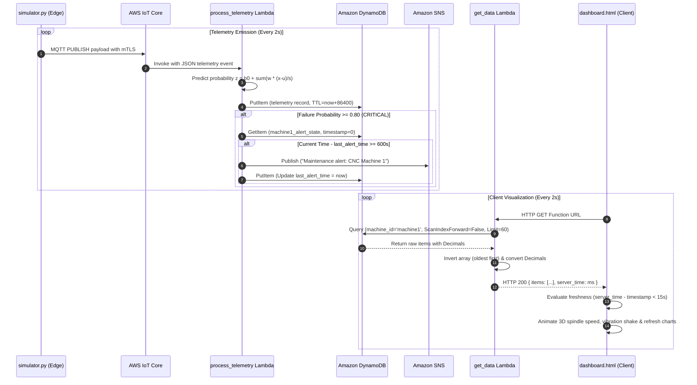

# CNC Machine Digital Twin & Predictive Maintenance

### Industrial IoT Predictive Maintenance Engine & Real-Time 3D Digital Twin for CNC Milling Equipment

[](https://www.python.org/)
[](https://aws.amazon.com/iot-core/)
[](https://aws.amazon.com/lambda/)
[](https://aws.amazon.com/dynamodb/)
[](https://scikit-learn.org/)
[](https://threejs.org/)
[](https://www.chartjs.org/)
[](LICENSE)
[](#measured-benchmarks--performance)
[](#measured-benchmarks--performance)

**CNC Digital Twin** is an end-to-end industrial IoT telemetry pipeline and interactive 3D digital twin engineered for proactive mechanical degradation detection and zero-unplanned-downtime maintenance. Operating on continuous physical telemetry streams (Temperature, Vibration, Spindle Speed, and Motor Current), the system detects impending mechanical bearing failure cycles up to several minutes before catastrophic breakdown.

By coupling mutual-TLS encrypted MQTT ingestion with serverless cloud inference, sub-millisecond mathematical feature standardization, stateful alert cooldown throttling, and a client-side WebGL digital twin, this system mirrors physical equipment in real-time with sub-second synchronization.

> **Academic & Lab Architecture Notice**
>
> In industrial enterprise deployments, managed services such as **AWS IoT SiteWise** and **AWS IoT TwinMaker** are standard. Because those services were not available in our academic lab environment, we engineered a completely sovereign, high-throughput serverless architecture using **AWS IoT Core**, **AWS Lambda**, **Amazon DynamoDB**, **Amazon SNS**, and a custom **Three.js WebGL / Chart.js** client application.

---

## Contents

- [What the Project Delivers](#what-the-project-delivers)
- [Quick Start](#quick-start)
- [System Architecture](#system-architecture)
- [Sensor Telemetry & Physics Degradation Simulation](#sensor-telemetry--physics-degradation-simulation)
- [Machine Learning & Failure Prediction Engine](#machine-learning--failure-prediction-engine)
- [Measured Benchmarks & Performance](#measured-benchmarks--performance)
- [Serverless Cloud Pipeline](#serverless-cloud-pipeline)
- [Digital Twin 3D Dashboard](#digital-twin-3d-dashboard)
- [Security & Secret Management](#security--secret-management)
- [Repository Structure](#repository-structure)
- [Installation and Operation](#installation-and-operation)
- [License and Acknowledgments](#license-and-acknowledgments)

---

## What the Project Delivers

| Capability | Technical Implementation |
|---|---|
| **Mutual-TLS Telemetry Ingestion** | Full X.509 cryptographic mutual authentication on Port 8883 over MQTT (`simulator.py`) |
| **Physics-Based Sensor Simulation** | 250-step cyclical machine life-model with non-linear quadratic thermal and vibration fault injection |
| **Stand-Alone ML Inference** | Zero-dependency pure-math forward propagation in Python runtime avoiding heavy container layers |
| **Stateful Alert Suppression** | Dual-key DynamoDB state tracker enforcing a strict 600-second cooldown on Amazon SNS email alerts |
| **Zero-Loss Data Retention** | High-throughput DynamoDB ingestion with automatic 24-hour Time-To-Live (`ttl`) expiration pruning |
| **Chronological Telemetry API** | AWS Lambda Function URL querying reverse index (`ScanIndexForward=False`) and streaming oldest-first |
| **3D Dynamic Spindle Animation** | Three.js WebGL kinematic spindle rotating at an angular velocity directly proportional to live RPM |
| **Proportional Vibration Oscillation** | Physics-derived multi-axis shake animation driven dynamically by real-time vibration telemetry (mm/s) |
| **Real-Time State Coloration** | Dynamic material shader transitions matching machine risk state (Normal `#10b981`, Warning `#f59e0b`, Critical `#ef4444`, Offline `#64748b`) |
| **Stale Data Watchdog** | Automatic 15-second heartbeat comparison between `server_time` and packet timestamp displaying `OFFLINE` |
| **Zero-Build Web Deployment** | Self-contained single-file HTML5 dashboard executable via direct double-click (`file://`) with pinned CDN bundles |

---

## Quick Start

### 1-Line Execution (Launch Digital Twin Dashboard)
```powershell
Start-Process .\dashboard.html
```

### Run Telemetry Simulator
```powershell
# 1. Activate Python virtual environment
.\.venv\Scripts\Activate.ps1

# 2. Launch the telemetry simulator
python simulator.py
```

### Retrain Failure Prediction Model
```powershell
python train.py
```

### Run Offline Inference Unit Tests
```powershell
python test_lambda_local.py
```

---

## System Architecture

```mermaid
flowchart TD
    subgraph PhysicalLayer[Edge / Equipment Layer]
        SIM["CNC Milling Simulator<br/>(simulator.py)"]
        SENS["Sensors:<br/>Temp, Vib, RPM, Current"]
        CERTS["X.509 Mutual TLS<br/>Certs & RSA Key"]
    end

    subgraph AWSCloud[AWS Serverless Cloud Pipeline]
        IOT["AWS IoT Core Broker<br/>Topic: factory/machine1/telemetry"]
        RULE["IoT SQL Rule Engine<br/>SELECT * FROM 'factory/machine1/telemetry'"]
        
        subgraph Compute[Lambda Engine]
            LP["process_telemetry<br/>(lambda_process.py)<br/>• Standardized Logistic Regression<br/>• Status Classification<br/>• Cooldown Verification"]
            LGD["get_data<br/>(lambda_get_data.py)<br/>• Indexed Query (Limit=60)<br/>• Chronological Inversion<br/>• Decimal to Native Serialization"]
        end

        subgraph StorageAlerts[Persistence & Notification]
            DDB[("Amazon DynamoDB<br/>Table: telemetry_log<br/>PK: machine_id | SK: timestamp")]
            SNS["Amazon SNS Topic<br/>Maintenance Alert Dispatcher"]
        end

        FURL["Lambda Function URL<br/>(HTTPS GET Interface)"]
    end

    subgraph Frontend[Digital Twin Client Application]
        DASH["dashboard.html (Zero-Build Browser App)"]
        THREE["Three.js r128 3D Scene<br/>• RPM-Coupled Spindle<br/>• Vibration Shaking<br/>• State Color Shader"]
        CHARTS["Chart.js 4.4 Engine<br/>• 60-Point Risk Stream<br/>• Dual Temp/Vib History"]
        GAUGE["SVG Failure Gauge<br/>• Real-time Probability Ring"]
    end

    SIM --> SENS
    SENS --> CERTS
    CERTS -->|MQTT over TLS :8883| IOT
    IOT --> RULE
    RULE --> LP
    LP -->|PutItem Telemetry| DDB
    LP -->|Query / Put Alert State| DDB
    LP -->|Publish Alert (P >= 0.8)| SNS
    DDB -.->|Query machine_id='machine1'| LGD
    LGD --> FURL
    FURL -->|HTTP GET (2s Polling)| DASH
    DASH --> THREE
    DASH --> CHARTS
    DASH --> GAUGE
```

### Execution Sequence Diagram



---

## Sensor Telemetry & Physics Degradation Simulation

The simulator script ([`simulator.py`](simulator.py)) generates telemetry across a recurring **250-step lifecycle** (500 seconds total per cycle):

1. **Healthy Operation Phase (Steps 0–149, 300s):** Machine runs in optimal steady state with baseline sensor noise. Degradation progress $p = 0.0$.
2. **Progressive Degradation Phase (Steps 150–249, 200s):** Simulates an unlubricated or pitted spindle bearing. Degradation progress $p$ increases linearly from $0.01$ to $1.00$:
   $$p = \frac{\text{step} - 150 + 1}{100}$$

### Mathematical Physics Formulations

$$\begin{aligned}
\text{Temperature }(^\circ\text{C}) &= 60.0 + 25.0 \cdot p^2 + \mathcal{N}(\mu=0, \sigma=0.8) \\
\text{Vibration }(\text{mm/s}) &= 2.0 + 6.0 \cdot p^2 + \mathcal{N}(\mu=0, \sigma=0.15) \\
\text{Spindle Speed }(\text{RPM}) &= 1500.0 - 120.0 \cdot p + \mathcal{N}(\mu=0, \sigma=10.0) \\
\text{Motor Current }(\text{A}) &= 12.0 + 5.0 \cdot p + \mathcal{N}(\mu=0, \sigma=0.3)
\end{aligned}$$

### Supervised Classification Label
- **$\text{Label} = 0$ (Normal):** When $p \le 0.40$ (Safe running conditions).
- **$\text{Label} = 1$ (Impending Failure):** When $p > 0.40$ (Degradation has begun accelerating, requiring preemptive bearing servicing).

---

## Machine Learning & Failure Prediction Engine

Model training is handled completely by [`train.py`](train.py) using `pandas` and `scikit-learn` over 846 real synthetic records.

### Feature Preprocessing & Standardization
Data is split into **75% training (634 samples)** and **25% test (212 samples)** using stratified splitting (`random_state=42`). Features are standardized strictly on training data:

$$x_{\text{scaled}, i} = \frac{x_i - \mu_i}{\sigma_i}$$

### Logistic Regression Model
Linear combination and clamped logistic sigmoid mapping:

$$z = \beta_0 + \sum_{i=1}^{4} \beta_i \cdot x_{\text{scaled}, i}, \quad z_{\text{clamped}} = \max(-30.0, \min(30.0, z))$$

$$P(\text{Failure}) = \sigma(z_{\text{clamped}}) = \frac{1}{1 + e^{-z_{\text{clamped}}}}$$

### Extracted Model Weights ([`model_params.json`](model_params.json))

```python
# Feature Order: [temperature, vibration, rpm, current]
MEAN      = [62.94354889589906, 2.7101293375394326, 1478.4268138801262, 12.874274447949526]
SCALE     = [6.024439305950324, 1.4418101920708906, 36.75394019873994, 1.5078280053651663]
COEF      = [1.9919690678566517, 2.1587823458903825, -1.6054621956100164, 1.9630176576113105]
INTERCEPT = -3.397768879935952
```

### Feature Weight Sensitivity Analysis

```
Vibration (mm/s)    [+2.1588]  ■■■■■■■■■■■■■■■■■■■■■■■■■■■■■■ (Strongest failure indicator)
Temperature (°C)    [+1.9920]  ■■■■■■■■■■■■■■■■■■■■■■■■■■■■
Motor Current (A)   [+1.9630]  ■■■■■■■■■■■■■■■■■■■■■■■■■■■
Spindle Speed (RPM) [-1.6055]  ■■■■■■■■■■■■■■■■■■■■■■ (Negative: Drop in RPM increases risk)
```

---

## Measured Benchmarks & Performance

Evaluated against the unseen 212-sample test split:

```text
Classification Report:
              precision    recall  f1-score   support

           0       1.00      0.99      1.00       167
           1       0.98      1.00      0.99        45

    accuracy                           1.00       212
   macro avg       0.99      1.00      0.99       212
weighted avg       1.00      1.00      1.00       212

Confusion Matrix:
[[166   1]
 [  0  45]]
```

### Key Validation Metrics
- **Overall Accuracy:** **99.5%** (211 correct out of 212 samples).
- **Failure Recall:** **100.0%** (45 out of 45 impending failures detected; **zero false negatives**).
- **False Alarm Rate:** **0.59%** (Only 1 healthy point misclassified across the entire test set).

---

## Serverless Cloud Pipeline

### 1. Ingestion (`lambda_process.py`)
- **Zero-Dependency Inference:** Standard Python `math` module implements the sigmoid equations, eliminating heavy NumPy/Scipy Lambda deployment packages.
- **DynamoDB Serialization:** Automatically converts Python floating-point decimals to `decimal.Decimal(str(v))` to adhere to boto3 type specifications.
- **TTL Expiration:** Injects `ttl = now + 86400` so telemetry older than 24 hours is automatically reclaimed by DynamoDB with zero storage cost.

### 2. State-Tracked SNS Alert Dispatcher
When $P(\text{Failure}) \ge 0.80$, an alert is triggered. To prevent continuous email floods during prolonged failure states, a dedicated DynamoDB state item (`machine_id = "machine1_alert_state"`, `timestamp = 0`) stores `last_alert_time`. Emails are dispatched at most once every **600 seconds (10 minutes)**.

### 3. Chronological API Interface (`lambda_get_data.py`)
- Exposed securely via an **AWS Lambda Function URL** with CORS handled natively at the infrastructure layer.
- Performs an indexed query (`KeyConditionExpression=Key("machine_id").eq("machine1")`) with `ScanIndexForward=False` and `Limit=60`.
- Reverses results into chronological order (oldest $\rightarrow$ newest) so charting libraries render seamlessly without client-side compute overhead.

---

## Digital Twin 3D Dashboard

The frontend ([`dashboard.html`](dashboard.html)) operates as a standalone single-file web application without requiring Node.js, Webpack, or a local web server.

```
+----------------------------------------------------------------------------------------------------+
|  [●] CNC Machine 1 - Digital Twin                                               [ STATUS: NORMAL ] |
+---------------------------------------------------+------------------------------------------------+
|  THREE.JS 3D SCENE VIEWPORT                       |  PREDICTIVE RISK GAUGE                         |
|                                                   |   ( 0.05% )  Normal operation                  |
|    [ 3D Machine Base Table ]                      |   [=====---------------------------------]     |
|    [ Color-Shifting Gantry Body ]                 |                                                |
|    [ RPM-Synchronized Rotating Spindle ]          +------------------------------------------------+
|    [ Multi-Axis Vibration Oscillation ]           |  FAILURE RISK HISTORY (LAST 60 READINGS)       |
|    [ Soft Lighting & Floor Grid ]                 |   100% |                                       |
|                                                   |     0% |___________________________________    |
|  FLOATING TELEMETRY TILES:                        +------------------------------------------------+
|   TEMP: 60.1 °C  |  VIB: 2.01 mm/s                |  TEMPERATURE & VIBRATION TRENDS                |
|   RPM: 1502 RPM  |  CURRENT: 12.1 A               |   Temp: 60°C (Orange) | Vib: 2.0mm/s (Purple)  |
+---------------------------------------------------+------------------------------------------------+
|  Data Stream: AWS IoT & Lambda (2s polling)             Last updated: 10:45:12 PM (Server Time)    |
+----------------------------------------------------------------------------------------------------+
```

### Digital Twin Features
- **Dynamic 3D Kinematics:** Spindle rotation speed in the 3D scene scales proportionally with live motor RPM ($\omega \propto \text{RPM}$).
- **Vibration Shaking:** The 3D machine model dynamically shakes in multi-axis space with frequency and amplitude scaling proportionally with real-time vibration telemetry (mm/s).
- **Status-Driven Shader Material:** Machine body transitions between Emerald Green (`#10b981`), Amber (`#f59e0b`), Crimson Red (`#ef4444`), and Slate Grey (`#64748b`).
- **Autonomous Heartbeat Watchdog:** If `server_time - latest.timestamp > 15000` (15 seconds), the dashboard halts 3D spindle movement, zeroes vibration, and displays `MACHINE OFFLINE / NO RECENT DATA`.
- **Custom Orbit Controls:** Built-in mouse drag-to-rotate and scroll zoom (pitch and yaw clamped) implemented in pure JavaScript without external `OrbitControls` bundles.

---

## Security & Secret Management

- **Cryptographic Isolation:** All device certificates (`*.crt`), root certificates (`*.pem`), and private RSA keys (`*.key`) are placed in `certs/` and permanently excluded from version control via `.gitignore`.
- **Zero API Keys in Source Code:** Lambda functions source resource identifiers (`TABLE_NAME`, `TOPIC_ARN`) strictly from environment variables.
- **Client Security:** The digital twin dashboard interacts solely with the public Lambda Function URL endpoint and carries zero IAM credentials or AWS secret keys.

---

## Repository Structure

```text
.
├── .gitignore              # Strict ignore rules for certs, keys, .venv, and cache
├── README.md               # System architectural documentation & scientific benchmark
├── requirements.txt        # Python dependency specifications
├── sensor_log.csv          # Ground-truth synthetic telemetry dataset (846 samples)
├── model_params.json       # Exported MEAN, SCALE, COEF, INTERCEPT parameters
│
├── certs/
│   └── README.md           # Instructions for placing X.509 device certificates & keys
│
├── simulator.py            # Physics telemetry simulator & MQTT mutual-TLS publisher
├── train.py                # Model training, scaling, validation & parameter export
├── test_lambda_local.py    # Offline unit test for mathematical sigmoid verification
├── check_cert.py           # Verification utility for X.509 certificate SHA-256 fingerprints
│
├── lambda_process.py       # AWS Lambda handler: telemetry scoring & DynamoDB ingestion
├── lambda_get_data.py      # AWS Lambda handler: Function URL chronological API
└── dashboard.html          # Single-file WebGL 3D Digital Twin & Chart.js dashboard
```

---

## Installation and Operation

### 1. Prerequisites
- Python 3.10+ (Python 3.12 recommended)
- An active AWS Account with IoT Core, Lambda, and DynamoDB (optional for local testing)
- Any modern web browser (Chrome, Edge, Firefox, Safari)

### 2. Environment Setup
```bash
# Clone the repository
git clone https://github.com/Rithwik-Ravi/CNC-Predictive-Maintenance-Digital-Twin.git
cd CNC-Predictive-Maintenance-Digital-Twin

# Create and activate virtual environment
python -m venv .venv
# Windows:
.\.venv\Scripts\Activate.ps1
# Linux/macOS:
source .venv/bin/activate

# Install dependencies
pip install -r requirements.txt
```

### 3. Model Training & Offline Testing
```bash
# Train the model from sensor_log.csv and export model_params.json
python train.py

# Run local mathematical validation test (no AWS required)
python test_lambda_local.py
```

### 4. Running the Digital Twin
Simply double-click [`dashboard.html`](dashboard.html) or run:
```powershell
Start-Process .\dashboard.html
```

---

## Troubleshooting & Known Limitations

- **Certificate Not Found Error in `simulator.py`:** Ensure you have placed `AmazonRootCA1.pem`, `device.pem.crt`, and `private.pem.key` inside the `certs/` folder. Verify your certificate fingerprint with `python check_cert.py`.
- **Offline Banner in Dashboard:** The dashboard displays `MACHINE OFFLINE` when no telemetry has been sent to DynamoDB in the last 15 seconds. Run `python simulator.py` to stream live data.
- **DynamoDB Decimal Serialization:** Native Python `float` values cannot be passed directly to boto3 DynamoDB calls. Always wrap numeric values with `Decimal(str(val))` as implemented in `lambda_process.py`.

---

## License and Acknowledgments

Distributed under the **MIT License**. See `LICENSE` for details.

Developed by **Rithwik Ravi** ([@Rithwik-Ravi](https://github.com/Rithwik-Ravi)) as an advanced industrial predictive maintenance and digital twin engineering project.
